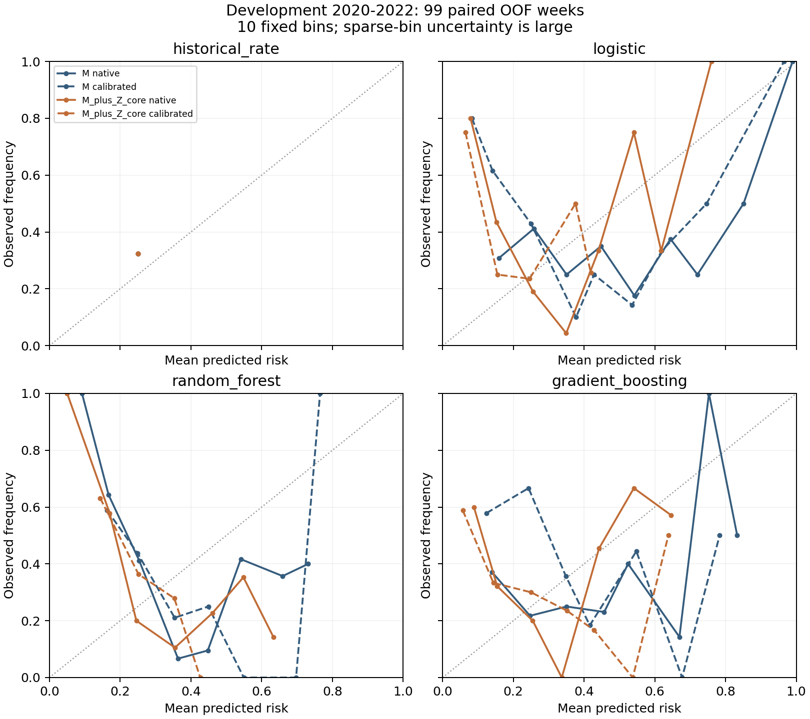

# Probability evaluation

| algorithm         | feature_set                    | sample_version          |   n |    brier |   log_loss |   roc_auc |   pr_auc |   calibrated_brier |   brier_lower |   brier_upper |   eligible_events |   detected_events |   lead_mean |
|:------------------|:-------------------------------|:------------------------|----:|---------:|-----------:|----------:|---------:|-------------------:|--------------:|--------------:|------------------:|------------------:|------------:|
| gradient_boosting | M                              | common_core_v1          |  99 | 0.245265 |   0.706305 |  0.516791 | 0.420972 |           0.27546  |     0.153847  |      0.323189 |                 9 |                 3 |     8.33333 |
| gradient_boosting | M                              | common_credit_v1        |  57 | 0.201077 |   0.65164  |  0.410638 | 0.189888 |           0.208724 |     0.080047  |      0.343296 |                 5 |                 1 |     1       |
| gradient_boosting | M                              | common_full_eligible_v1 |  56 | 0.203803 |   0.66536  |  0.394565 | 0.195774 |           0.21013  |     0.0746149 |      0.348733 |                 5 |                 1 |     1       |
| gradient_boosting | M                              | common_growth_v1        |  97 | 0.264931 |   0.764176 |  0.423077 | 0.372226 |           0.271745 |     0.169872  |      0.342135 |                 9 |                 3 |     8.33333 |
| gradient_boosting | M                              | common_prices_v1        |  99 | 0.245265 |   0.706305 |  0.516791 | 0.420972 |           0.27546  |     0.153847  |      0.323189 |                 9 |                 3 |     8.33333 |
| gradient_boosting | M                              | common_rates_fx_v1      |  99 | 0.245265 |   0.706305 |  0.516791 | 0.420972 |           0.27546  |     0.153847  |      0.323189 |                 9 |                 3 |     8.33333 |
| gradient_boosting | M                              | main_v1                 |  99 | 0.245265 |   0.706305 |  0.516791 | 0.420972 |           0.27546  |     0.153847  |      0.323189 |                 9 |                 3 |     8.33333 |
| gradient_boosting | M_plus_Z_core                  | common_core_v1          |  99 | 0.235545 |   0.70806  |  0.481343 | 0.413767 |           0.269754 |     0.140878  |      0.319553 |                 9 |                 4 |     8       |
| gradient_boosting | M_plus_Z_core_without_credit   | common_core_v1          |  99 | 0.228828 |   0.668461 |  0.521222 | 0.425929 |           0.257133 |     0.14052   |      0.299367 |                 9 |                 4 |     8       |
| gradient_boosting | M_plus_Z_core_without_growth   | common_core_v1          |  99 | 0.2302   |   0.695787 |  0.503265 | 0.438357 |           0.266823 |     0.138784  |      0.312318 |                 9 |                 5 |     8.8     |
| gradient_boosting | M_plus_Z_core_without_prices   | common_core_v1          |  99 | 0.244348 |   0.730617 |  0.482976 | 0.39768  |           0.269816 |     0.156328  |      0.325131 |                 9 |                 3 |     8.33333 |
| gradient_boosting | M_plus_Z_core_without_rates_fx | common_core_v1          |  99 | 0.233126 |   0.698963 |  0.507929 | 0.429008 |           0.26866  |     0.142259  |      0.314564 |                 9 |                 5 |     8.8     |
| gradient_boosting | M_plus_Z_credit                | common_credit_v1        |  57 | 0.176538 |   0.618184 |  0.396809 | 0.278329 |           0.184085 |     0.0672787 |      0.317552 |                 5 |                 2 |     1       |
| gradient_boosting | M_plus_Z_full_eligible         | common_full_eligible_v1 |  56 | 0.182514 |   0.629066 |  0.404348 | 0.299553 |           0.187528 |     0.0698222 |      0.322288 |                 5 |                 2 |     1       |
| gradient_boosting | M_plus_Z_growth                | common_growth_v1        |  97 | 0.279667 |   0.808149 |  0.362981 | 0.307525 |           0.249507 |     0.174168  |      0.363538 |                 9 |                 1 |     1       |
| gradient_boosting | M_plus_Z_prices                | common_prices_v1        |  99 | 0.22824  |   0.66508  |  0.532882 | 0.438987 |           0.253832 |     0.143819  |      0.292706 |                 9 |                 4 |    10.5     |
| gradient_boosting | M_plus_Z_rates_fx              | common_rates_fx_v1      |  99 | 0.24894  |   0.740218 |  0.447994 | 0.424008 |           0.243289 |     0.150698  |      0.317588 |                 9 |                 4 |    10.5     |
| historical_rate   | M                              | common_core_v1          |  99 | 0.2246   |   0.644083 |  0.380597 | 0.280347 |           0.2246   |     0.143419  |      0.301138 |                 9 |                 0 |   nan       |
| historical_rate   | M                              | common_credit_v1        |  57 | 0.147673 |   0.475537 |  0.287234 | 0.142915 |           0.147673 |     0.0507734 |      0.257853 |                 5 |                 0 |   nan       |
| historical_rate   | M                              | common_full_eligible_v1 |  56 | 0.149691 |   0.480281 |  0.286957 | 0.145238 |           0.149691 |     0.051172  |      0.261528 |                 5 |                 0 |   nan       |
| historical_rate   | M                              | common_growth_v1        |  97 | 0.229258 |   0.65501  |  0.477885 | 0.317904 |           0.229258 |     0.143548  |      0.309768 |                 9 |                 0 |   nan       |
| historical_rate   | M                              | common_prices_v1        |  99 | 0.2246   |   0.644083 |  0.380597 | 0.280347 |           0.2246   |     0.143419  |      0.301138 |                 9 |                 0 |   nan       |
| historical_rate   | M                              | common_rates_fx_v1      |  99 | 0.2246   |   0.644083 |  0.380597 | 0.280347 |           0.2246   |     0.143419  |      0.301138 |                 9 |                 0 |   nan       |
| historical_rate   | M                              | main_v1                 |  99 | 0.2246   |   0.644083 |  0.380597 | 0.280347 |           0.2246   |     0.143419  |      0.301138 |                 9 |                 0 |   nan       |
| historical_rate   | M_plus_Z_core                  | common_core_v1          |  99 | 0.2246   |   0.644083 |  0.380597 | 0.280347 |           0.2246   |     0.143419  |      0.301138 |                 9 |                 0 |   nan       |
| historical_rate   | M_plus_Z_core_without_credit   | common_core_v1          |  99 | 0.2246   |   0.644083 |  0.380597 | 0.280347 |           0.2246   |     0.143419  |      0.301138 |                 9 |                 0 |   nan       |
| historical_rate   | M_plus_Z_core_without_growth   | common_core_v1          |  99 | 0.2246   |   0.644083 |  0.380597 | 0.280347 |           0.2246   |     0.143419  |      0.301138 |                 9 |                 0 |   nan       |
| historical_rate   | M_plus_Z_core_without_prices   | common_core_v1          |  99 | 0.2246   |   0.644083 |  0.380597 | 0.280347 |           0.2246   |     0.143419  |      0.301138 |                 9 |                 0 |   nan       |
| historical_rate   | M_plus_Z_core_without_rates_fx | common_core_v1          |  99 | 0.2246   |   0.644083 |  0.380597 | 0.280347 |           0.2246   |     0.143419  |      0.301138 |                 9 |                 0 |   nan       |
| historical_rate   | M_plus_Z_credit                | common_credit_v1        |  57 | 0.147673 |   0.475537 |  0.287234 | 0.142915 |           0.147673 |     0.0507734 |      0.257853 |                 5 |                 0 |   nan       |
| historical_rate   | M_plus_Z_full_eligible         | common_full_eligible_v1 |  56 | 0.149691 |   0.480281 |  0.286957 | 0.145238 |           0.149691 |     0.051172  |      0.261528 |                 5 |                 0 |   nan       |
| historical_rate   | M_plus_Z_growth                | common_growth_v1        |  97 | 0.229258 |   0.65501  |  0.477885 | 0.317904 |           0.229258 |     0.143548  |      0.309768 |                 9 |                 0 |   nan       |
| historical_rate   | M_plus_Z_prices                | common_prices_v1        |  99 | 0.2246   |   0.644083 |  0.380597 | 0.280347 |           0.2246   |     0.143419  |      0.301138 |                 9 |                 0 |   nan       |
| historical_rate   | M_plus_Z_rates_fx              | common_rates_fx_v1      |  99 | 0.2246   |   0.644083 |  0.380597 | 0.280347 |           0.2246   |     0.143419  |      0.301138 |                 9 |                 0 |   nan       |
| logistic          | M                              | common_core_v1          |  99 | 0.254465 |   0.707498 |  0.503265 | 0.429165 |           0.269107 |     0.188895  |      0.310159 |                 9 |                 3 |     4.66667 |
| logistic          | M                              | common_credit_v1        |  57 | 0.176794 |   0.543269 |  0.395745 | 0.192334 |           0.17858  |     0.0979609 |      0.262538 |                 5 |                 1 |     1       |
| logistic          | M                              | common_full_eligible_v1 |  56 | 0.177272 |   0.543955 |  0.404348 | 0.197849 |           0.180028 |     0.0963963 |      0.262844 |                 5 |                 1 |     1       |
| logistic          | M                              | common_growth_v1        |  97 | 0.242034 |   0.684095 |  0.503365 | 0.428613 |           0.261273 |     0.167922  |      0.299082 |                 9 |                 4 |     8.5     |
| logistic          | M                              | common_prices_v1        |  99 | 0.254465 |   0.707498 |  0.503265 | 0.429165 |           0.269107 |     0.188895  |      0.310159 |                 9 |                 3 |     4.66667 |
| logistic          | M                              | common_rates_fx_v1      |  99 | 0.254465 |   0.707498 |  0.503265 | 0.429165 |           0.269107 |     0.188895  |      0.310159 |                 9 |                 3 |     4.66667 |
| logistic          | M                              | main_v1                 |  99 | 0.254465 |   0.707498 |  0.503265 | 0.429165 |           0.269107 |     0.188895  |      0.310159 |                 9 |                 3 |     4.66667 |
| logistic          | M_plus_Z_core                  | common_core_v1          |  99 | 0.242176 |   0.71997  |  0.459422 | 0.414419 |           0.260553 |     0.160125  |      0.323314 |                 9 |                 2 |    12       |
| logistic          | M_plus_Z_core_without_credit   | common_core_v1          |  99 | 0.22894  |   0.679582 |  0.502799 | 0.458088 |           0.254076 |     0.139862  |      0.307426 |                 9 |                 4 |     7.25    |
| logistic          | M_plus_Z_core_without_growth   | common_core_v1          |  99 | 0.242128 |   0.719826 |  0.459422 | 0.414419 |           0.260537 |     0.160084  |      0.323235 |                 9 |                 2 |    12       |
| logistic          | M_plus_Z_core_without_prices   | common_core_v1          |  99 | 0.237396 |   0.705977 |  0.486474 | 0.442436 |           0.262292 |     0.159777  |      0.319099 |                 9 |                 3 |     9.33333 |
| logistic          | M_plus_Z_core_without_rates_fx | common_core_v1          |  99 | 0.232815 |   0.670483 |  0.497201 | 0.450572 |           0.251528 |     0.164291  |      0.293198 |                 9 |                 4 |     6       |
| logistic          | M_plus_Z_credit                | common_credit_v1        |  57 | 0.157634 |   0.517867 |  0.555319 | 0.293677 |           0.170874 |     0.069287  |      0.251747 |                 5 |                 1 |     1       |
| logistic          | M_plus_Z_full_eligible         | common_full_eligible_v1 |  56 | 0.171771 |   0.538582 |  0.456522 | 0.264515 |           0.172289 |     0.0912584 |      0.256691 |                 5 |                 1 |     1       |
| logistic          | M_plus_Z_growth                | common_growth_v1        |  97 | 0.259536 |   2.23343  |  0.539904 | 0.358561 |           0.278738 |     0.153752  |      0.350052 |                 9 |                 0 |   nan       |
| logistic          | M_plus_Z_prices                | common_prices_v1        |  99 | 0.215606 |   0.668589 |  0.631996 | 0.483421 |           0.233018 |     0.109599  |      0.285749 |                 9 |                 4 |     6       |
| logistic          | M_plus_Z_rates_fx              | common_rates_fx_v1      |  99 | 0.240248 |   0.710131 |  0.526119 | 0.450567 |           0.248519 |     0.155924  |      0.320882 |                 9 |                 3 |    10.3333  |
| random_forest     | M                              | common_core_v1          |  99 | 0.283921 |   0.786075 |  0.403918 | 0.337018 |           0.269185 |     0.218871  |      0.337126 |                 9 |                 2 |     4.5     |
| random_forest     | M                              | common_credit_v1        |  57 | 0.220621 |   0.648141 |  0.380851 | 0.150671 |           0.189819 |     0.123401  |      0.315954 |                 5 |                 0 |   nan       |
| random_forest     | M                              | common_full_eligible_v1 |  56 | 0.220126 |   0.646416 |  0.386957 | 0.155471 |           0.19164  |     0.121623  |      0.313236 |                 5 |                 0 |   nan       |
| random_forest     | M                              | common_growth_v1        |  97 | 0.253598 |   0.726726 |  0.419231 | 0.373828 |           0.257343 |     0.171008  |      0.314095 |                 9 |                 3 |     8.33333 |
| random_forest     | M                              | common_prices_v1        |  99 | 0.283921 |   0.786075 |  0.403918 | 0.337018 |           0.269185 |     0.218871  |      0.337126 |                 9 |                 2 |     4.5     |
| random_forest     | M                              | common_rates_fx_v1      |  99 | 0.283921 |   0.786075 |  0.403918 | 0.337018 |           0.269185 |     0.218871  |      0.337126 |                 9 |                 2 |     4.5     |
| random_forest     | M                              | main_v1                 |  99 | 0.283921 |   0.786075 |  0.403918 | 0.337018 |           0.269185 |     0.218871  |      0.337126 |                 9 |                 2 |     4.5     |
| random_forest     | M_plus_Z_core                  | common_core_v1          |  99 | 0.2954   |   0.850488 |  0.331157 | 0.271882 |           0.26061  |     0.219763  |      0.356593 |                 9 |                 1 |     4       |
| random_forest     | M_plus_Z_core_without_credit   | common_core_v1          |  99 | 0.290219 |   0.839923 |  0.365205 | 0.353227 |           0.255862 |     0.214028  |      0.34449  |                 9 |                 2 |    12       |
| random_forest     | M_plus_Z_core_without_growth   | common_core_v1          |  99 | 0.301496 |   0.85753  |  0.326493 | 0.288244 |           0.260909 |     0.22631   |      0.364085 |                 9 |                 1 |     4       |
| random_forest     | M_plus_Z_core_without_prices   | common_core_v1          |  99 | 0.306102 |   0.87233  |  0.335354 | 0.2899   |           0.264347 |     0.229816  |      0.370688 |                 9 |                 1 |     4       |
| random_forest     | M_plus_Z_core_without_rates_fx | common_core_v1          |  99 | 0.235189 |   0.680047 |  0.456157 | 0.396044 |           0.252993 |     0.162171  |      0.297352 |                 9 |                 3 |     8.33333 |
| random_forest     | M_plus_Z_credit                | common_credit_v1        |  57 | 0.205332 |   0.606212 |  0.37234  | 0.148009 |           0.182799 |     0.121557  |      0.299645 |                 5 |                 0 |   nan       |
| random_forest     | M_plus_Z_full_eligible         | common_full_eligible_v1 |  56 | 0.157191 |   0.504873 |  0.430435 | 0.246451 |           0.1728   |     0.0727015 |      0.252578 |                 5 |                 1 |     1       |
| random_forest     | M_plus_Z_growth                | common_growth_v1        |  97 | 0.280817 |   0.77312  |  0.361058 | 0.281152 |           0.241161 |     0.217255  |      0.342188 |                 9 |                 0 |   nan       |
| random_forest     | M_plus_Z_prices                | common_prices_v1        |  99 | 0.251302 |   0.712735 |  0.437034 | 0.390289 |           0.249781 |     0.186361  |      0.298915 |                 9 |                 2 |    12       |
| random_forest     | M_plus_Z_rates_fx              | common_rates_fx_v1      |  99 | 0.270477 |   0.758988 |  0.384328 | 0.313805 |           0.247687 |     0.199985  |      0.327539 |                 9 |                 1 |     5       |

Primary metric: native probability Brier. Calibrated Brier is a separately reported diagnostic. 95% intervals use 8-calendar-week moving blocks, 500 replicates, seed 3059. Small event counts limit inference. PR-AUC is average precision. Reliability bins and per-sample probabilities are in experiments/.

Native probabilities are primary. Dashed calibrated curves are diagnostics; bins may be sparse. PDF export is available beside the PNG.
